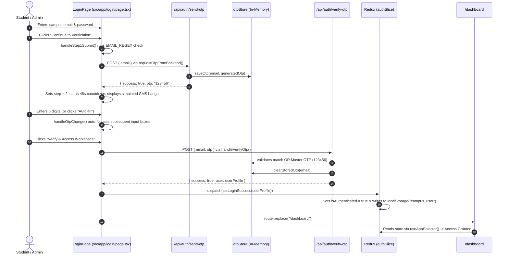
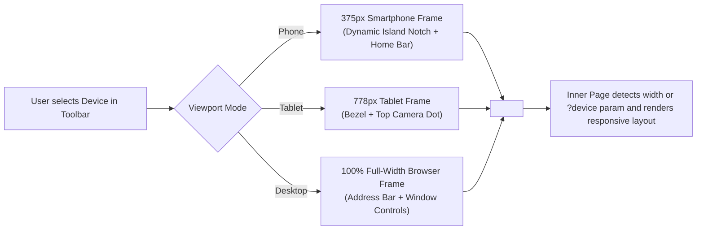
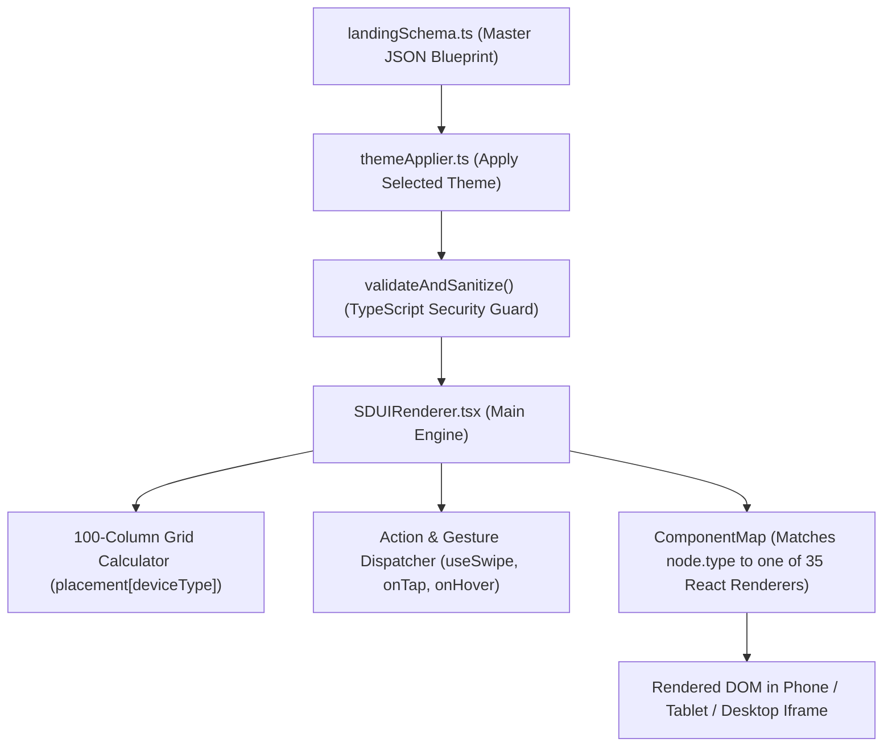
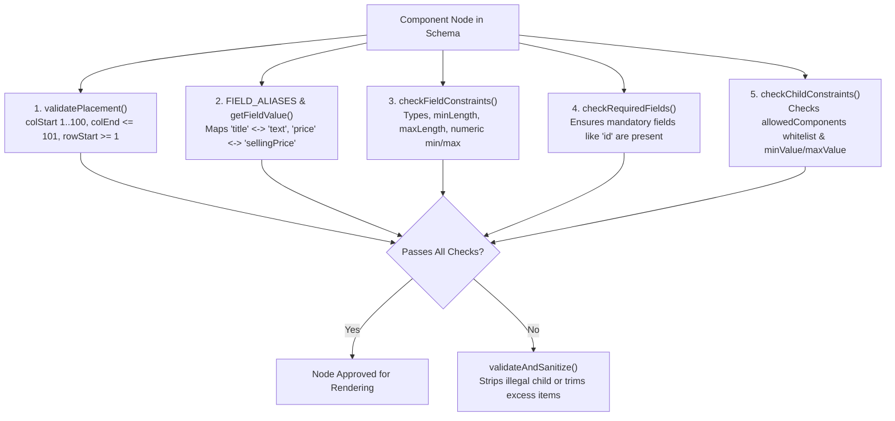

# Campus Commerce — Architecture & Implementation Guide

A beginner-friendly, comprehensive reference guide explaining the architecture, end-to-end data flows, function lifecycles, and component engines of the **Campus Commerce** application.

---

## 1. Project Overview & Tech Stack

**Campus Commerce** is a campus marketplace and workspace platform designed for students and administrators. It features multi-step two-factor authentication, responsive device previews (Phone, Tablet, Desktop), and a **Server-Driven UI (SDUI)** engine that renders an entire e-commerce storefront from dynamic JSON schemas with instant theme switching and runtime validation.

### Core Technologies
- **Framework**: [Next.js 16](https://nextjs.org/) (App Router with Turbopack)
- **Language**: [TypeScript](https://www.typescriptlang.org/) (Strict typing across schemas, slices, and renderers)
- **Styling**: [Tailwind CSS v4](https://tailwindcss.com/) (With custom design tokens in [globals.css](file:///d:/Programming/Campus_Commerce/src/app/globals.css))
- **State Management**: [Redux Toolkit](https://redux-toolkit.js.org/) (With automatic `localStorage` session synchronization)
- **UI Architecture**: **Server-Driven UI (SDUI)** interpreting JSON blueprints onto a **100-column responsive virtual CSS grid**
- **Safety & Validation**: Pure TypeScript validation suite enforcing component constraints, child whitelisting, and crash-proof runtime sanitization

### Application Routes & Purposes

| Route | File Location | Access | Description / Purpose |
| :--- | :--- | :--- | :--- |
| `/` | [src/app/page.tsx](file:///d:/Programming/Campus_Commerce/src/app/page.tsx) | Public | Root redirector; routes visitors directly to `/login`. |
| `/login` | [src/app/login/page.tsx](file:///d:/Programming/Campus_Commerce/src/app/login/page.tsx) | Public | Multi-step 2FA login (Step 1: Email & Password, Step 2: 6-digit OTP). |
| `/dashboard` | [src/app/dashboard/page.tsx](file:///d:/Programming/Campus_Commerce/src/app/dashboard/page.tsx) | **Protected** | Admin/Student workspace dashboard guarded by Redux authentication state. |
| `/landing-content` | [src/app/landing-content/page.tsx](file:///d:/Programming/Campus_Commerce/src/app/landing-content/page.tsx) | Standalone / Iframe | Embedded route running the SDUI engine & runtime validator for ThemeStudio iframe previews. |
| `/pages/dummy` | [src/app/pages/dummy/page.tsx](file:///d:/Programming/Campus_Commerce/src/app/pages/dummy/page.tsx) | Protected | Responsive device iframe wrapper embedding `/dummy-content`. |
| `/dummy-content` | [src/app/dummy-content/page.tsx](file:///d:/Programming/Campus_Commerce/src/app/dummy-content/page.tsx) | Standalone / Iframe | Interactive campus noticeboard and peer exchange preview. |
| `/pages/product` | [src/app/pages/product/page.tsx](file:///d:/Programming/Campus_Commerce/src/app/pages/product/page.tsx) | Protected | Product catalog with metric cards and Yan copilot assistant. |
| `/pages/orders` | [src/app/pages/orders/page.tsx](file:///d:/Programming/Campus_Commerce/src/app/pages/orders/page.tsx) | Protected | Campus orders list and fulfillment tracking. |
| `/pages/customers` | [src/app/pages/customers/page.tsx](file:///d:/Programming/Campus_Commerce/src/app/pages/customers/page.tsx) | Protected | Customer directory and student accounts management. |
| `/api/themes/validate` | [src/app/api/themes/validate/route.ts](file:///d:/Programming/Campus_Commerce/src/app/api/themes/validate/route.ts) | Public API | **Check 1 (Backend)**: Validates SDUI theme schemas before opening the ThemeSlider popup. |


---

## 2. Directory Tree & Architecture Overview

```
src/
├── app/                                # Next.js App Router (Routes & Layouts)
│   ├── api/auth/
│   │   ├── send-otp/route.ts           # Generates 6-digit OTP & caches in backend memory
│   │   └── verify-otp/route.ts         # Validates OTP match or Master OTP (123456)
│   ├── api/themes/
│   │   └── validate/route.ts           # Check 1: Server-side validation of SDUI theme blueprints
│   ├── dashboard/
│   │   └── page.tsx                    # Protected dashboard home; redirects unauthenticated users
│   ├── dummy-content/
│   │   └── page.tsx                    # Standalone sample noticeboard page for iframe embedding
│   ├── landing-content/
│   │   └── page.tsx                    # Standalone route running SDUIRenderer + Theme Bundle + Validator
│   ├── pages/
│   │   ├── dummy/page.tsx              # Dummy viewer with Phone/Tablet/Desktop device mockups
│   │   ├── welcome/page.tsx            # Welcome screen & Theme Selection trigger
│   │   ├── product/page.tsx            # Product catalog & AI copilot screen
│   │   ├── orders/page.tsx             # Orders listing screen
│   │   └── customers/page.tsx          # Customers directory screen
│   ├── login/
│   │   └── page.tsx                    # 2-step Auth screen (Credentials + OTP verification)
│   ├── layout.tsx                      # Root layout wrapping Redux StoreProvider
│   ├── globals.css                     # Tailwind CSS v4 design tokens & base theme rules
│   └── page.tsx                        # Root redirect to /login
├── components/
│   ├── Header.tsx                      # Global top navigation bar (User badge, search, mobile menu trigger)
│   ├── Sidebar.tsx                     # Responsive sidebar (Desktop rail + Mobile swipeable drawer)
│   ├── ThemeSlider.tsx                 # Theme selection & SDUI component studio modal
│   └── iframe/                         # Reusable Responsive Iframe Module
│       ├── types.ts                    # ViewportMode, Mockup & Toolbar prop interfaces
│       ├── PhoneMockup.tsx             # Smartphone shell with dynamic island notch & status bar
│       ├── TabletMockup.tsx            # Tablet shell with camera dot bezel
│       ├── DesktopMockup.tsx           # Browser window with window traffic dots & address bar
│       ├── IframeToolbar.tsx           # Viewport mode toggles (desktop/tablet/phone), reload, new tab
│       ├── IframeViewer.tsx            # Main container uniting mockups, toolbar, & responsive autoscaling
│       └── index.ts                    # Barrel export for seamless imports (`@/components/iframe`)
├── lib/
│   └── otpStore.ts                     # In-memory OTP storage with master bypass key
├── store/                              # Redux State Management
│   ├── slices/authSlice.ts             # Auth slice (User profile, isAuthenticated, localStorage sync)
│   ├── hooks.ts                        # Typed Redux hooks (`useAppDispatch`, `useAppSelector`)
│   ├── store.ts                        # Redux Toolkit store configuration
│   └── StoreProvider.tsx               # Client-side Redux Provider wrapper
└── sdui/                               # Server-Driven UI (SDUI) Subsystem
    ├── types.ts                        # Core TypeScript definitions (SDUINode, GridPlacement, SDUIAction)
    ├── landingSchema.ts                # Master 100-column JSON blueprint (~3,400 lines) with clean emojis
    ├── SDUIRenderer.tsx                # Main SDUI rendering engine (100-column grid calculator & dispatcher)
    ├── hooks/
    │   └── useSwipe.ts                 # Touch & mouse drag gesture hook for mobile carousels
    ├── renderers/                      # 35 Modular React Component Renderers
    │   ├── HeaderRenderer.tsx, ProductCardRenderer.tsx, CarouselRenderer.tsx...
    ├── themeBundle/                    # SDUI Precompiled Theme Bundles
    │   ├── index.ts                    # Master registry of Theme 1, Theme 2, Theme 3
    │   ├── theme1.json                 # Classic Campus Teal Brand theme
    │   ├── theme2.json                 # Clean Minimalist White theme
    │   └── theme3.json                 # Obsidian Dark Campus theme
    └── validators/                     # Schema Validation & Runtime Sanitizer
        ├── index.ts                    # Exports ALL_RULES and validator functions
        ├── validator.ts                # TypeScript Validator Engine (Grid, fields, whitelist, sanitizer)
        └── rules/                      # 36 Rule JSON Definitions
            ├── productCard.json, productList.json, carousel.json, index.ts...
```

---

## 3. End-to-End Authentication Lifecycle

Authentication uses a 2-step verification flow: First, students enter their credentials; second, a 6-digit OTP is verified. An in-memory store manages active OTPs, and a universal **Master OTP (`123456`)** provides reliable access during testing.



### Authentication Details for Beginners

1. **Step 1: Credential Submission (`step === 1`)**:
   - The user inputs their college email and password into [login/page.tsx](file:///d:/Programming/Campus_Commerce/src/app/login/page.tsx).
   - `handleStep1Submit` verifies the format using an email regex and calls `requestOtpFromBackend(cleanEmail)`.
   - The Next.js API route [send-otp/route.ts](file:///d:/Programming/Campus_Commerce/src/app/api/auth/send-otp/route.ts) generates a 6-digit random code and saves it to [otpStore.ts](file:///d:/Programming/Campus_Commerce/src/lib/otpStore.ts).
   - The login page switches to `step = 2`, triggers a 48-second resend countdown, and displays a simulated SMS toast banner with an **Auto-fill** button.

2. **Step 2: OTP Verification (`step === 2`)**:
   - 6 individual input boxes allow fluid typing via `handleOtpChange` (auto-focusing the next box) and `handleOtpKeyDown` (auto-focusing the previous box on Backspace).
   - Submitting fires `handleVerifyOtp`, sending `{ email, otp }` to [verify-otp/route.ts](file:///d:/Programming/Campus_Commerce/src/app/api/auth/verify-otp/route.ts).
   - The backend checks against [otpStore.ts](file:///d:/Programming/Campus_Commerce/src/lib/otpStore.ts). **Master OTP `123456` always passes**, making development and testing hassle-free.
   - On success, the API responds with the user's complete profile object.

3. **Step 3: Redux Storage & Route Guarding**:
   - The user profile is dispatched via `setLoginSuccess(user)` in [authSlice.ts](file:///d:/Programming/Campus_Commerce/src/store/slices/authSlice.ts).
   - Redux saves `isAuthenticated: true` in memory and mirrors the session into `localStorage.setItem("campus_user", ...)`.
   - When [dashboard/page.tsx](file:///d:/Programming/Campus_Commerce/src/app/dashboard/page.tsx) mounts, it checks Redux. If not authenticated and no `campus_user` is found in `localStorage`, it redirects to `/login`.
   - Clicking **Log Out** in [Sidebar.tsx](file:///d:/Programming/Campus_Commerce/src/components/Sidebar.tsx) triggers `dispatch(logout())`, clearing Redux, deleting the `localStorage` key, and routing back to `/login`.

---

## 4. Key Functions, Hooks & Triggers Reference

| Function / Hook | Location | Trigger / Event | Description |
| :--- | :--- | :--- | :--- |
| `handleStep1Submit` | [login/page.tsx](file:///d:/Programming/Campus_Commerce/src/app/login/page.tsx) | "Continue to Verification" button | Validates email syntax and triggers backend OTP generation. |
| `requestOtpFromBackend` | [login/page.tsx](file:///d:/Programming/Campus_Commerce/src/app/login/page.tsx) | Submit or "Resend code" button | Dispatches `POST /api/auth/send-otp` to generate and cache a 6-digit code. |
| `handleOtpChange` | [login/page.tsx](file:///d:/Programming/Campus_Commerce/src/app/login/page.tsx) | Typing in any of the 6 OTP input boxes | Validates numeric input and auto-focuses the next digit box. |
| `handleOtpKeyDown` | [login/page.tsx](file:///d:/Programming/Campus_Commerce/src/app/login/page.tsx) | Pressing `Backspace` in an OTP box | Auto-focuses the previous digit box when the current one is empty. |
| `handleVerifyOtp` | [login/page.tsx](file:///d:/Programming/Campus_Commerce/src/app/login/page.tsx) | "Verify & Access Workspace" button | Dispatches `POST /api/auth/verify-otp`, checks code or Master OTP, and triggers Redux login. |
| `setLoginSuccess` | [authSlice.ts](file:///d:/Programming/Campus_Commerce/src/store/slices/authSlice.ts) | Verified OTP API response | Updates state (`isAuthenticated = true`) and persists user to `localStorage`. |
| `logout` | [authSlice.ts](file:///d:/Programming/Campus_Commerce/src/store/slices/authSlice.ts) | Sidebar "Log Out" button | Resets auth state to `null` and deletes `campus_user` from `localStorage`. |
| `useSwipe` | [useSwipe.ts](file:///d:/Programming/Campus_Commerce/src/sdui/hooks/useSwipe.ts) | Touch & Mouse drag gestures | Measures horizontal/vertical drag delta. Triggers callbacks when delta exceeds 50px. |
| `applyThemeToSchema` | [themeApplier.ts](file:///d:/Programming/Campus_Commerce/src/sdui/themes/themeApplier.ts) | Theme selection change | Applies theme presets, adjusts contrast, and preserves 100-column grid placements. |
| `validatePlacement` | [validator.ts](file:///d:/Programming/Campus_Commerce/src/sdui/validators/validator.ts) | Schema validation pass | Ensures `colStart` (1..100), `colEnd` (<=101), `rowStart`, and `rowEnd` are valid. |
| `validate` | [validator.ts](file:///d:/Programming/Campus_Commerce/src/sdui/validators/validator.ts) | Direct inspection call | Validates a node or tree against a specific component rule JSON. |
| `validateFullTree` | [validator.ts](file:///d:/Programming/Campus_Commerce/src/sdui/validators/validator.ts) | Full schema validation | Inspects every node in a tree against all 36 registered component rules. |
| `validateAndSanitize` | [validator.ts](file:///d:/Programming/Campus_Commerce/src/sdui/validators/validator.ts) | Landing content load & theme switch | Strips illegal children and trims excess items to prevent browser crashes. |
| `setViewport` | [landing/page.tsx](file:///d:/Programming/Campus_Commerce/src/app/pages/landing/page.tsx) | Desktop / Tablet / Phone buttons | Switches the iframe container between Phone (375px), Tablet (778px), and Desktop (100%). |
| `handleReload` | [landing/page.tsx](file:///d:/Programming/Campus_Commerce/src/app/pages/landing/page.tsx) | "Reload" button (🔄) | Forces the iframe to re-render by incrementing its React key. |

---

## 5. Responsive Device Viewer & Iframe Subsystem

Both `/pages/landing` and `/pages/dummy` use an **outer dashboard shell + inner embedded iframe** pattern. This allows testing realistic responsive layouts directly inside the browser.



### Viewport Modes
1. **📱 Phone Mockup (375px)**:
   - Outer smartphone chassis with rounded corners (`rounded-[44px]`).
   - Dynamic Island / camera notch centered at the top.
   - iOS-style bottom home indicator bar.
   - Hidden visible scrollbars (`scrollbar-none`) while retaining native touch and mousewheel scrolling.
2. **💻 Tablet Mockup (778px)**:
   - Modern tablet frame (`max-w-[778px]`) with aluminum edge styling.
   - Subtle top-center camera dot.
3. **🖥️ Desktop Mockup (100% Full Width)**:
   - Browser chrome header with red, yellow, and green window dots.
   - Interactive address bar displaying the active route with a copy button and custom URL navigation.

---

## 6. Server-Driven UI (SDUI) Architecture

### What is Server-Driven UI?
In traditional web development, page structure, components, and layouts are hard-coded in React. In **Server-Driven UI (SDUI)**, the page layout, component types, content, and styling are declared in a **JSON schema** ([landingSchema.ts](file:///d:/Programming/Campus_Commerce/src/sdui/landingSchema.ts)). The frontend acts as a dynamic rendering engine. This allows changing layouts, reordering sections, or updating themes without redeploying frontend code.



### The 100-Column Virtual CSS Grid
SDUI positions all components on a **100-column responsive grid**:
- The parent container sets `display: grid; grid-template-columns: repeat(100, 1fr)`.
- Every component defines its placement for each device mode:
  ```json
  "placement": {
    "mobile":  { "colStart": 1, "colEnd": 101, "rowStart": 1, "rowEnd": 2 },
    "tablet":  { "colStart": 1, "colEnd": 51,  "rowStart": 1, "rowEnd": 2 },
    "desktop": { "colStart": 1, "colEnd": 34,  "rowStart": 1, "rowEnd": 2 }
  }
  ```
- [SDUIRenderer.tsx](file:///d:/Programming/Campus_Commerce/src/sdui/SDUIRenderer.tsx) dynamically computes:
  ```css
  grid-column: 1 / 101;
  grid-row: 1 / 2;
  ```

---

## 7. Component Renderers Reference (35 Components)

Every component in [src/sdui/renderers/](file:///d:/Programming/Campus_Commerce/src/sdui/renderers/) is a pure, self-contained React component that accepts `BaseRendererProps` (containing `node`, `deviceType`, `onAction`, etc.):

| Category | Component File | Key State / Hooks | Visual Description & Responsibilities |
| :--- | :--- | :--- | :--- |
| **Navigation & Header** | [HeaderRenderer.tsx](file:///d:/Programming/Campus_Commerce/src/sdui/renderers/HeaderRenderer.tsx) | Layout | Top header container with padding, background styling, and child placement. |
| | [HeaderButtonRenderer.tsx](file:///d:/Programming/Campus_Commerce/src/sdui/renderers/HeaderButtonRenderer.tsx) | `onClick` | Rounded action button inside the header with icon and text label. |
| | [NavBarRenderer.tsx](file:///d:/Programming/Campus_Commerce/src/sdui/renderers/NavBarRenderer.tsx) | `onNavigate` | Bottom mobile app bar with icons, labels, and active route highlight. |
| | [SearchBarRenderer.tsx](file:///d:/Programming/Campus_Commerce/src/sdui/renderers/SearchBarRenderer.tsx) | `useState(query)` | Rounded search bar with search icon and 500ms debounced input. |
| | [FooterRenderer.tsx](file:///d:/Programming/Campus_Commerce/src/sdui/renderers/FooterRenderer.tsx) | Hover states | Multi-column footer with quick links, copyright, and campus badge. |
| **Commerce & Products** | [ProductCardRenderer.tsx](file:///d:/Programming/Campus_Commerce/src/sdui/renderers/ProductCardRenderer.tsx) | `useState(isHovered)` | Product card with image, title, price block, and hover `⚡ Quick Add` pill. |
| | [ProductListRenderer.tsx](file:///d:/Programming/Campus_Commerce/src/sdui/renderers/ProductListRenderer.tsx) | Layout | Horizontal scrolling or grid product list container. |
| | [PriceBlockRenderer.tsx](file:///d:/Programming/Campus_Commerce/src/sdui/renderers/PriceBlockRenderer.tsx) | Layout | Displays selling price, strikethrough original MRP, and discount tag. |
| | [BadgeRenderer.tsx](file:///d:/Programming/Campus_Commerce/src/sdui/renderers/BadgeRenderer.tsx) | Layout | Compact pill badge (e.g., "50% OFF", "Best Seller", "Campus Verified"). |
| | [OfferTextRenderer.tsx](file:///d:/Programming/Campus_Commerce/src/sdui/renderers/OfferTextRenderer.tsx) | Layout | Highlighted promotional text banner with gradient accent wording. |
| | [DeliveryInfoRenderer.tsx](file:///d:/Programming/Campus_Commerce/src/sdui/renderers/DeliveryInfoRenderer.tsx) | Layout | Delivery information with truck icon (`🚚 FREE delivery by tomorrow`). |
| | [RatingRenderer.tsx](file:///d:/Programming/Campus_Commerce/src/sdui/renderers/RatingRenderer.tsx) | Layout | Star rating display with numeric value. |
| | [ScoreRenderer.tsx](file:///d:/Programming/Campus_Commerce/src/sdui/renderers/ScoreRenderer.tsx) | Layout | Review score container (e.g. "4.8 out of 5"). |
| | [ReviewCountRenderer.tsx](file:///d:/Programming/Campus_Commerce/src/sdui/renderers/ReviewCountRenderer.tsx) | Layout | Formatted review count text. |
| **Banners & Marketing** | [CarouselRenderer.tsx](file:///d:/Programming/Campus_Commerce/src/sdui/renderers/CarouselRenderer.tsx) | `useSwipe`, `useState` | Auto-playing promotional carousel with slide indicators and swipe support. |
| | [HeroBannerRenderer.tsx](file:///d:/Programming/Campus_Commerce/src/sdui/renderers/HeroBannerRenderer.tsx) | Layout | Full-width promotional banner with title and subtitle overlay. |
| | [CouponCodeRenderer.tsx](file:///d:/Programming/Campus_Commerce/src/sdui/renderers/CouponCodeRenderer.tsx) | `useState(copied)` | Dashed coupon box with copy-to-clipboard button (`Copied!`). |
| | [CountDownTimerRenderer.tsx](file:///d:/Programming/Campus_Commerce/src/sdui/renderers/CountDownTimerRenderer.tsx) | `useState`, `useEffect` | Live ticking countdown timer until target expiry timestamp. |
| **Discovery & Social** | [CategoryGridRenderer.tsx](file:///d:/Programming/Campus_Commerce/src/sdui/renderers/CategoryGridRenderer.tsx) | Layout | Horizontal scrolling category container. |
| | [CategoryItemRenderer.tsx](file:///d:/Programming/Campus_Commerce/src/sdui/renderers/CategoryItemRenderer.tsx) | `onClick` | Circular category icon with label. |
| | [StoryRowRenderer.tsx](file:///d:/Programming/Campus_Commerce/src/sdui/renderers/StoryRowRenderer.tsx) | Layout | Horizontal scrolling student stories container. |
| | [StoryCircleRenderer.tsx](file:///d:/Programming/Campus_Commerce/src/sdui/renderers/StoryCircleRenderer.tsx) | `onClick` | Gradient-bordered circular story avatar. |
| **Containers & Primitives** | [PageRenderer.tsx](file:///d:/Programming/Campus_Commerce/src/sdui/renderers/PageRenderer.tsx) | Layout | The core 100-column CSS Grid container (`repeat(100, 1fr)`). |
| | [HomeRenderer.tsx](file:///d:/Programming/Campus_Commerce/src/sdui/renderers/HomeRenderer.tsx) | Layout | Top-level page container wrapping the Page grid and bottom NavBar. |
| | [BoxRenderer.tsx](file:///d:/Programming/Campus_Commerce/src/sdui/renderers/BoxRenderer.tsx) | Layout | Styled generic container for grouping child elements. |
| | [ButtonRenderer.tsx](file:///d:/Programming/Campus_Commerce/src/sdui/renderers/ButtonRenderer.tsx) | `onClick` | Standalone call-to-action button with custom styling. |
| | [ShareButtonRenderer.tsx](file:///d:/Programming/Campus_Commerce/src/sdui/renderers/ShareButtonRenderer.tsx) | `onClick` | Share action button with share icon. |
| | [TitleRenderer.tsx](file:///d:/Programming/Campus_Commerce/src/sdui/renderers/TitleRenderer.tsx) | Layout | Bold section headline typography. |
| | [DescriptionRenderer.tsx](file:///d:/Programming/Campus_Commerce/src/sdui/renderers/DescriptionRenderer.tsx) | Layout | Multi-line text description with line clamping. |
| | [TextRenderer.tsx](file:///d:/Programming/Campus_Commerce/src/sdui/renderers/TextRenderer.tsx) | Layout | Standard paragraph text block. |
| | [LabelRenderer.tsx](file:///d:/Programming/Campus_Commerce/src/sdui/renderers/LabelRenderer.tsx) | Layout | Small label or subtitle text. |
| | [SponsoredRenderer.tsx](file:///d:/Programming/Campus_Commerce/src/sdui/renderers/SponsoredRenderer.tsx) | Layout | "Sponsored" tag label. |
| | [IconRenderer.tsx](file:///d:/Programming/Campus_Commerce/src/sdui/renderers/IconRenderer.tsx) | `onClick` | Standalone SVG/emoji icon button. |
| | [ImageRenderer.tsx](file:///d:/Programming/Campus_Commerce/src/sdui/renderers/ImageRenderer.tsx) | Layout | Responsive image component with aspect ratio handling. |
| | [IFrameRenderer.tsx](file:///d:/Programming/Campus_Commerce/src/sdui/renderers/IFrameRenderer.tsx) | Layout | Sandboxed iframe embed component. |

---

## 8. SDUI Theme Engine

The theme engine allows switching the appearance of the entire storefront instantly without altering page layout coordinates.

### The 3 Core Theme Presets

```
🎨 Default Campus Teal (landing_schema)
   ├── Primary: Deep Teal (#0D3540)
   ├── Accent: Emerald Green (#10B981)
   └── Background: Warm Paper (#FAFAF8)

⚪ Clean Minimalist White (clean_white)
   ├── Primary: Crisp White (#FFFFFF)
   ├── Accent: Modern Indigo (#4F46E5)
   └── Background: Pure White (#FFFFFF)

⚫ Obsidian Dark Mode (black_minimal)
   ├── Primary: Obsidian Black (#090D16)
   ├── Accent: Cyber Sky Blue (#38BDF8)
   └── Background: Dark Slate (#090D16)
```

### How `themeApplier.ts` Works
The function `applyThemeToSchema(schema, themeId)` in [themeApplier.ts](file:///d:/Programming/Campus_Commerce/src/sdui/themes/themeApplier.ts) transforms the schema through a 3-step pipeline:

1. **Section Replacement**:
   - Matches section types (Header, SearchBar, StoryRow, CategoryGrid, Carousel, HeroBanner, CouponCode, CountDownTimer, ProductList, ProductGrid, Footer, NavBar).
   - Replaces content and styles from matching theme JSON files in [src/sdui/themes/](file:///d:/Programming/Campus_Commerce/src/sdui/themes/).
   - **Crucial Rule**: Preserves existing `placement` coordinates so switching themes never alters grid positions!
2. **Subtree Contrast Adjustment (`applyThemeToSubtree`)**:
   - Recursively traverses children to ensure text is readable against the theme background.
   - Text elements (Title, Description, PriceBlock, Label) pull high-contrast colors from `TEXT_COLORS`.
   - In Dark Mode, light container backgrounds (`#FFFFFF`, `#FAFAF8`) are automatically converted to obsidian slate (`#090D16`).
3. **Card & Button Theming**:
   - Updates `ProductCard`, `Button`, and `Badge` styles to match the theme preset.

---

## 9. SDUI Validation Suite & Runtime Sanitizer

The validation suite in [src/sdui/validators/](file:///d:/Programming/Campus_Commerce/src/sdui/validators/) protects the application from malformed JSON, illegal component nesting, and invalid grid coordinates.

### Beginner Analogy: The Airport Security Checkpoint
1. **The Theme JSON** is the traveler (carrying data, styles, and child components).
2. **The 36 Rule JSONs** ([src/sdui/validators/rules/](file:///d:/Programming/Campus_Commerce/src/sdui/validators/rules/)) are the rulebook (e.g. "A `ProductList` can only hold `ProductCard` items", "A `Title` cannot have 5,000 characters").
3. **The Validator Engine** ([validator.ts](file:///d:/Programming/Campus_Commerce/src/sdui/validators/validator.ts)) is the inspector. It inspects incoming data, catches errors, and cleans up invalid nodes so the application never crashes.

### Anatomy of a Rule JSON (`src/sdui/validators/rules/*.json`)
```json
{
  "type": "ProductCard",
  "displayName": "Product Card",
  "category": "Commerce",
  "isCompulsory": true,
  "allowedComponents": [
    "Image", "Badge", "Sponsored", "Label", "PriceBlock", "Title",
    "Description", "Rating", "Score", "ReviewCount", "OfferText",
    "DeliveryInfo", "Button", "ShareButton", "Box", "Icon", "Text"
  ],
  "minValue": 0,
  "maxValue": 15,
  "allowedActions": ["onTap", "onSwipe", "onDoubleTap", "onLongPress"],
  "requiredDataFields": ["id"],
  "fields": {
    "id": { "type": "string", "minLength": 1, "maxLength": 50 }
  }
}
```

### The 5 Modular Validation Checks



1. **Grid Placement Check (`validatePlacement`)**:
   - Verifies `colStart` is between 1 and 100.
   - Verifies `colEnd` is greater than `colStart` and at most 101.
   - Verifies `rowStart` >= 1 and `rowEnd` > `rowStart`.
2. **Field Synonym Resolution (`FIELD_ALIASES`)**:
   - Backend APIs and theme files often use different names for the same property. The dictionary automatically resolves aliases (e.g. `title` &harr; `text`, `sellingPrice` &harr; `price`, `couponCode` &harr; `code`).
3. **Data Field Constraints (`checkFieldConstraints`)**:
   - Validates types (`string`, `number`, `boolean`). Automatically coerces numeric counts to strings when needed.
   - Enforces string length boundaries (`minLength`, `maxLength`).
   - Enforces numeric value ranges (`min`, `max`).
4. **Mandatory Fields Check (`checkRequiredFields`)**:
   - Confirms essential properties exist (e.g. `id` on `ProductCard`).
5. **Child Constraints & Whitelist (`checkChildConstraints`)**:
   - Leaf components (`allowedComponents: []`) cannot have children.
   - Container components only accept children present in their `allowedComponents` list.
   - Child count must satisfy `minValue <= count <= maxValue`.

### The Runtime Sanitizer (`validateAndSanitize`)
When untrusted or dynamic JSON is passed to the renderer, `validateAndSanitize(schema)` guarantees safety:
- **Unknown Component Detection**: If a child's type is not registered in `ALL_RULES`, it is cleanly stripped.
- **Disallowed Child Removal**: If a child component is placed inside an incompatible parent (e.g. a `Footer` inside a `ProductCard`), the child is removed without crashing the parent.
- **Excess Children Trimming**: If a list defines `maxValue: 10` but receives 15 items, the extra 5 items are safely sliced off.
- **Surviving Tree Returned**: Returns `{ sanitizedSchema, isValid, errors, removedComponents }`.

### Live Runtime Pipeline in `/landing-content`
```typescript
// src/app/landing-content/page.tsx
const themedSchema = useMemo(() => {
  // 1. Apply selected theme preset
  const rawThemed = applyThemeToSchema(fullPageJSON, requestedTheme);
  
  // 2. Sanitize against all 36 component validation rules
  const { sanitizedSchema, errors } = validateAndSanitize(rawThemed);
  
  if (errors.length > 0) {
    console.warn("[SDUI Security Guard] Sanitized nodes:", errors);
  }
  
  // 3. Return clean, crash-proof schema to SDUIRenderer
  return sanitizedSchema;
}, [requestedTheme]);
```

---

## 10. Summary Checklist of Completed Features

- [x] **Multi-Step 2FA Authentication**:
  - Email format validation & credentials step.
  - In-memory OTP storage ([otpStore.ts](file:///d:/Programming/Campus_Commerce/src/lib/otpStore.ts)) with universal Master OTP bypass (`123456`).
  - Redux state persistence synchronized with `localStorage`.
  - Protected dashboard route guard ([dashboard/page.tsx](file:///d:/Programming/Campus_Commerce/src/app/dashboard/page.tsx)).
- [x] **Responsive Device Viewer & Mockups**:
  - 🖥️ Desktop browser frame (100% full-width).
  - 💻 Tablet mockup (778px bezel frame with top camera dot).
  - 📱 Smartphone mockup (375px frame with realistic Dynamic Island notch and home bar).
  - Synchronized `?device=` and `?theme=` URL parameters.
- [x] **Server-Driven UI Engine**:
  - 100-column virtual CSS grid calculator supporting mobile, tablet, and desktop coordinates.
  - 35 individual React component renderers in [src/sdui/renderers/](file:///d:/Programming/Campus_Commerce/src/sdui/renderers/).
  - Touch and mouse swipe gesture detection via [useSwipe.ts](file:///d:/Programming/Campus_Commerce/src/sdui/hooks/useSwipe.ts).
  - Action handlers for tap, long press, hover, and debounced search.
- [x] **Theme Customization Subsystem**:
  - 35 component theme JSON files in [src/sdui/themes/](file:///d:/Programming/Campus_Commerce/src/sdui/themes/).
  - 3 curated presets: Default Campus Teal (`landing_schema`), Clean Minimalist White (`clean_white`), and Obsidian Dark Mode (`black_minimal`).
  - Placement-preserving theme applier engine ([themeApplier.ts](file:///d:/Programming/Campus_Commerce/src/sdui/themes/themeApplier.ts)).
  - Live theme toggle pills in the `/pages/landing` toolbar.
- [x] **TypeScript Validation Suite & Runtime Sanitizer**:
  - 36 component rule definitions in [src/sdui/validators/rules/](file:///d:/Programming/Campus_Commerce/src/sdui/validators/rules/).
  - Field alias dictionary resolving common naming synonyms.
  - 100-column grid coordinate boundaries validator.
  - Crash-proof runtime sanitizer ([validateAndSanitize](file:///d:/Programming/Campus_Commerce/src/sdui/validators/validator.ts)) that strips illegal components and trims excess children.
- [x] **Code Quality & Build Verification**:
  - 100% TypeScript compilation (`npx tsc --noEmit` &rarr; 0 errors).
  - Clean UTF-8 emoji encoding across all schemas and renderers.


Next Task : 
I want to create a theme bundle...and it will contain themes i.e. landing_schema theme that can be copied as it is from landingschema.js similarly clean white theme and black theme...everything should be same design styles action children everything will be same just we will change the colour for white and black theme...and these themes will be stored in redux....but there was a problem for each theme the 3000 lines of json was a problem...as it will take so many kbs of space so how can reduce that tell me the best solution for it ...and why this solution is there any other solution...tell me pros and cons of that solution and why are you choosing this solution ...then after this ...we will the request will go to backend ...it will validate the whole schema like we have validator logic...validate and validatefulltree and validatesanitize that trim the extra components that are not needed...but now we have to change the logic to if the theme has any errors then that theme will not be shown to user when he click on landing page..if 1 theme has any type of error then that theme will not shown ...and that errors will be shown in the backend or console that because of these errors the theme is not rendered...
After that we will now start creating our journey...on clicking on landing page....a slider will open where there will be 4 options for now..the three themes and last option will be "Build your own theme" or custom theme...and if user select one of the three themes then he will be taken to that theme and will se the landing page....
for now we will not build the custom theme journey....we will first build the three themes journey....after that we will start working on building our own theme and its journey....
And after this I dont think there will be any need of themes folder and in validator folder we have to change the logic of validatesanitize and all...and I think there is no need of themeapplier as well...so also list the files that are not necessary then we will remove that as well...
I hope you understand everything for now....
Please ensure that everything should be properly responsive for desktop,tablet as well as phone ...also ensure that the code should be very simple , easy to understand , beginner friendly as I am a newbie...


There are some changes...in the current plan....so As you know I want to create a theme bundle...and it will contain themes i.e. landing_schema theme that can be copied as it is from landingschema.js similarly clean white theme and black theme....and we will repplace these names as theme1 theme2 and theme3 also we will replace the name of landing page and give it as eCommerce...everything should be same design styles action children everything will be same just we will change the colour for white and black theme...as well as it possible we will change the links of images and placements so it will give new look for different themes...and these themes will be stored in redux....but there was a problem for each theme the 3000 lines of json was a problem...as it will take so many kbs of space so how can reduce that tell me the best solution for it ...and why this solution is there any other solution...tell me pros and cons of that solution and why are you choosing this solution ...then after this ...we will the request will go to backend ...it will validate the whole schema like we have validator logic...validate and validatefulltree and validatesanitize that trim the extra components that are not needed...but now we have to change the logic to if the theme has any errors then that theme will not be shown to user when he click on eCommerce page..if 1 theme has any type of error then that theme will not shown ...and that errors will be shown in the backend or console like if theme3 has errors after valitor validates then console will show likr theme3 has this this errors....that because of these errors the theme is not rendered...
After that we will now start creating our journey...on clicking on landing page....a slider will open where there will be 3 options for now..as we have three themes ...and if user select one of the three themes then he will be taken to that theme and will see the landing page....But before that....each theme has a preview option on clicking the preview button the slider will move to the left slowly and an iframe will appear means something like that animation or transition I want...in that iframe user will see the landing page theme on which he has selected the preview in all desktop tablet and phone view ....also on clicking on preview it will defaultly click on preview theme then there will be another option to preview components where he can actually see the components how they look like means there will be cards like header , product card etc ...and on clicking the card a flip animation will appear and user will see the actual theme of the card...that how it looks like and after all this on clicking use theme this will navigate him to the eCommerce page where he can see the landing page...but for now we will not build the custom theme journey....we will first build the three themes journey....after that we will start working on building our own theme and its journey....
And after this I dont think there will be any need of themes folder and in validator folder we have to change the logic of validatesanitize and all...and I think there is no need of themeapplier as well...so also list the files that are not necessary then we will remove that as well...
I hope you understand everything for now....
Please ensure that everything should be properly responsive for desktop,tablet as well as phone ...also ensure that the code should be very simple , easy to understand , beginner friendly as I am a newbie... 

6. Step-by-Step Implementation Procedure
We will build this methodically in 6 easy-to-follow steps:

Step 1: Create the Theme Bundle Module
Create src/sdui/themeBundle/:
theme1.ts (Campus Teal — base schema)
theme2.ts (Clean White — custom light styling, distinct images & layout)
theme3.ts (Obsidian Dark — custom dark styling, distinct images & layout)
index.ts (Theme registry)
Step 2: Update Validator with Strict Quarantine Policy
Refactor 

validator.ts
 with validateThemeStrict().
Log full error details to the console and mark failing themes as quarantined.
Step 3: Setup Redux Store (themeSlice.ts)
Manage theme metadata, active theme schema, preview states, and quarantined errors.
Wire into src/store/store.ts.
Step 4: Build the Responsive Theme Slider with Animation & Component Flip Cards
Create ThemeSlider.tsx with:
Left-shift slide animation when Preview is clicked.
Responsive Iframe preview (Desktop, Tablet, Phone views).
"Preview Theme" tab (Full page iframe).
"Preview Components" tab with 3D Flip Card animations showing Header, ProductCard, etc.
"Use Theme" button.
Step 5: Rename to "eCommerce" & Connect Routes
Update Sidebar, Header, and page routes (/pages/ecommerce or updated /pages/landing).
Test theme switching and iframe communication across Desktop, Tablet, and Mobile.
Step 6: Remove the 37 Obsolete Files & Final Verification
Safely delete the 37 old files in src/sdui/themes/.
Run npx tsc --noEmit to ensure 100% clean TypeScript build with zero errors.

now ...in welcome page ....
when user click on welcome page ...a beutiful small pop up will appear 
welcoming user with a text like....thank you for using this website...before moving forward...you have to select a theme...something like that and when user click on proceed button then the pop up will disappear....
do this first then we will move forward
as we have created ecommerce page...similarly we are now actually and properly implementig that in welcome page...okay

---

## 11. Two-Tier Theme Validation Architecture (Backend + Frontend)

To ensure maximum resilience and speed, theme validation uses a **2-tier defense-in-depth pipeline**:

```mermaid
sequenceDiagram
    autonumber
    actor Student as User / Student
    participant Welcome as Welcome Page (/pages/welcome)
    participant API as Backend Route (/api/themes/validate)
    participant Redux as Redux (themeSlice)
    participant Studio as ThemeSlider Modal
    participant Engine as Frontend SDUI (/landing-content)

    %% Check 1: Backend
    Student->>Welcome: Clicks "Proceed" or "Select Theme"
    Welcome->>API: GET /api/themes/validate (Check 1: Backend Validation)
    API->>API: Runs validateThemeStrict() across all JSON themes
    API-->>Welcome: { success: true, results: { theme1: { isValid, isDisabled }, ... } }
    Welcome->>Redux: Dispatches validateThemesBackend.fulfilled
    Welcome->>Studio: Opens ThemeSlider with verified status

    %% Check 2: Frontend
    Student->>Studio: Clicks "Use Theme" / "Apply Theme"
    Studio->>Redux: dispatch(setActiveTheme(themeId))
    Redux->>Redux: Security Guard: Rejects if isDisabled === true
    Studio->>Engine: Renders /landing-content in iframe
    Engine->>Engine: validateThemeStrict() (Check 2: Frontend Shield)
    Engine-->>Student: Displays error card if disabled; renders <SDUIRenderer /> if valid
```

### Highlights:
1. **Startup Optimization**: Removed heavy synchronous validation (`validateThemeStrict`) from initial Redux store startup (`buildInitialThemes()`), ensuring rapid page boot and zero SSR hydration delays.
2. **Check 1 (Backend Validation)**: Called before opening `ThemeSlider`. The server runs `validateThemeStrict` on each theme schema via `GET /api/themes/validate` and tags each theme with `isValid` and `isDisabled`.
3. **Check 2 (Frontend Crash Guard)**:
   - When clicking "Apply Theme", Redux checks `themeInfo?.isDisabled` and refuses activation if invalid.
   - When `/landing-content` renders in the preview iframe, it re-verifies the theme before `<SDUIRenderer />` mounts.